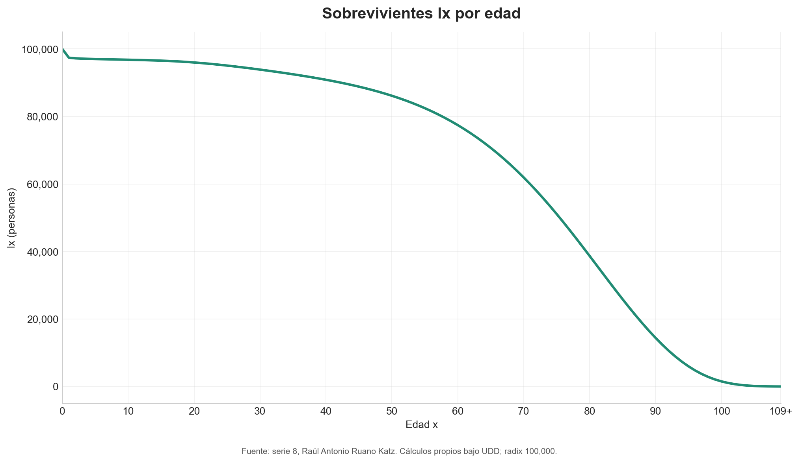

# Construcción y validación de una tabla de mortalidad

Proyecto académico realizado durante la **Maestría en Estadística Aplicada** de la
Universidad de San Carlos de Guatemala, dentro del curso de Estadística Actuarial.
Esta versión de portafolio fue preparada por Raúl Antonio Ruano Katz.



## Objetivo

Construir una tabla de mortalidad completa a partir de tasas específicas por edad,
validar sus identidades biométricas y producir automáticamente un libro de Excel,
un informe PDF y visualizaciones de diagnóstico.

## Metodología

- transformación de tasas centrales `mx` a probabilidades de muerte `qx`;
- cálculo recursivo de `lx`, `dx`, `Lx`, `Tx` y esperanza de vida `ex`;
- radix inicial de 100,000 personas;
- cierre del intervalo abierto de 109 años y más;
- doce controles automáticos de consistencia y recurrencia;
- exportación reproducible a Excel, PDF y PNG.

## Privacidad y material académico

El repositorio contiene únicamente la serie de tasas necesaria, sin nombres,
registros académicos ni datos de otros estudiantes. No se incluyen libros,
enunciados, plantillas ni soluciones proporcionadas por docentes.

## Resultado destacado

La tabla generada obtuvo una esperanza de vida al nacimiento de 70.63 años. Los
doce controles de recurrencia, cierre y consistencia se cumplieron; la suma de
defunciones coincide con el radix de 100,000 personas. El informe reproducible
contiene 16 páginas y once gráficas diagnósticas.

## Estructura

```text
├── data/
│   └── mortality_rates_series_08.csv
├── src/
│   └── generate_mortality_table.py
├── outputs/
│   ├── figures/
│   ├── mortality_table_series_08.xlsx
│   └── mortality_table_report.pdf
└── requirements.txt
```

## Reproducción

```bash
python -m pip install -r requirements.txt
python src/generate_mortality_table.py
```

El script detiene la ejecución si alguna identidad actuarial no cumple la
tolerancia definida o si los archivos generados no superan la validación final.

## Alcance

Los resultados tienen fines educativos. Las tasas y cálculos no deben utilizarse
para tarificación, reservas o decisiones actuariales reales sin revisión y
validación profesional adicional.

